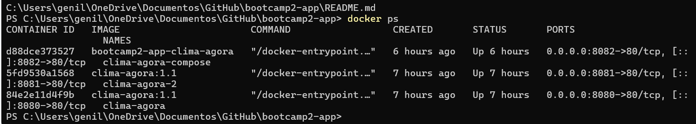

# Clima Agora

## Autor

Damylle dos Santos Oliveira — Matrícula: 22553445

## Descrição

O Clima Agora é uma aplicação web que permite consultar informações climáticas de diferentes cidades. O usuário informa o nome de uma cidade e recebe dados como temperatura, umidade e velocidade do vento.

## API utilizada

* Open-Meteo
* API de Geocoding da Open-Meteo
* API de previsão do tempo da Open-Meteo

## Funcionalidades

* Busca de cidades pelo nome.
* Consulta da temperatura atual.
* Consulta da umidade do ar.
* Consulta da velocidade do vento.
* Exibição das coordenadas da cidade.
* Mensagem quando a cidade não é encontrada.
* Mensagem de erro caso não seja possível consultar a API.
* Interface adaptada para dispositivos menores.

## Como executar localmente

1. Clone o repositório:

```bash
git clone https://github.com/damyllee/bootcamp2-app.git
```

2. Abra a pasta do projeto no IntelliJ ou outro editor.
3. Abra o arquivo `index.html` no navegador.

## Links

- **Aplicação no ar (GitHub Pages):** https://damyllee.github.io/bootcamp2-app/
* **Repositório:** https://github.com/damyllee/bootcamp2-app.git

## Persistência de dados com Supabase

O Clima Agora utiliza o Supabase, um serviço de banco de dados PostgreSQL, para armazenar as cidades favoritas.

Os dados são armazenados na tabela `favoritos`, que contém os seguintes campos:

- `id`: identificador do registro.
- `created_at`: data e hora do cadastro.
- `nome_cidade`: nome da cidade favorita.
- `latitude`: latitude da cidade.
- `longitude`: longitude da cidade.

A aplicação permite salvar, listar e excluir cidades favoritas diretamente no banco de dados.

Os registros permanecem armazenados mesmo após atualizar a página ou fechar o navegador.

Como limitação de segurança desta etapa acadêmica, caso sejam utilizadas políticas RLS públicas para acesso anônimo, os favoritos podem ficar acessíveis a outros usuários. Em uma aplicação real, seria necessário implementar autenticação e políticas de acesso individuais.

## Docker

O projeto Clima Agora pode ser executado utilizando Docker e Docker Compose.

### Docker Hub

As imagens do projeto estão disponíveis em:

https://hub.docker.com/r/damyllee/clima-agora

**Versões publicadas:**
- 1.0
- 1.1
- latest

### Como executar com Docker

Primeiro, baixe a imagem do Clima Agora disponível no Docker Hub:

```bash
docker pull damyllee/clima-agora:latest
```

Depois, execute o contêiner:

```bash
docker run -d -p 8080:80 --name clima-agora damyllee/clima-agora:latest
```

Após iniciar o contêiner, abra no navegador:

http://localhost:8080

### Como executar com Docker Compose

Na pasta do projeto, execute:

```bash
docker compose up -d --build
```

Acesse no navegador: http://localhost:8082


### Verificar os contêineres

```bash
docker ps
```

### Tecnologias utilizadas

- HTML, CSS e JavaScript
- Open-Meteo API
- Docker
- Docker Compose
- Nginx

## Arquivo .dockerignore

O arquivo `.dockerignore` é utilizado para impedir que arquivos desnecessários sejam enviados durante a construção da imagem Docker.

No projeto, ele exclui arquivos como `.git`, `README.md` e arquivos temporários.

Isso ajuda a reduzir o tamanho do contexto de construção e pode tornar o processo de build mais rápido e eficiente.

## Orquestração com Kubernetes
Se eu tivesse 100 contêineres, seria difícil administrar todos manualmente. Para resolver isso, utilizaria o Kubernetes, uma ferramenta que ajuda a gerenciar vários contêineres automaticamente.
O Kubernetes organiza os servidores em um cluster. As aplicações são executadas dentro de pods, que podem conter um ou mais contêineres.
Também é possível criar réplicas, permitindo executar várias cópias da aplicação. Se uma delas apresentar problemas, o Kubernetes pode criar outra para manter o serviço funcionando. 
Assim, o Kubernetes facilita o gerenciamento, a disponibilidade e o crescimento da aplicação.

## Evidência dos contêineres Docker

A imagem abaixo mostra os contêineres do Clima Agora em execução nas portas 8080, 8081 e 8082.


